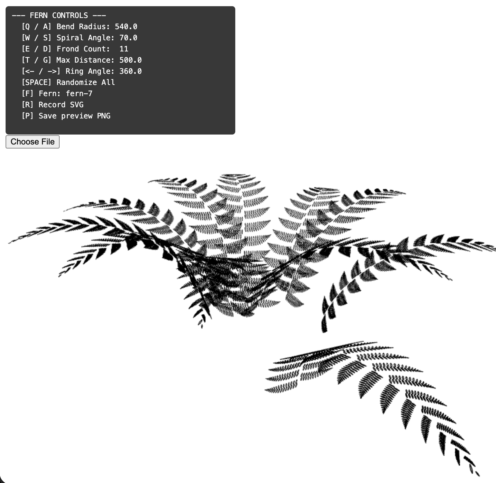

# Fern 3D

A p5.js sketch that turns fronds generated by the [Fern Synthesizer](https://github.com/summasmiff/fern-synthesizer) into an interactive 3D fern. Includes customization options via key command and SVG export of 3D renders.

[Try it out](https://summasmiff.github.io/fern-3d/)
[Read the blog post](https://summasmiff.github.io/2026/10/19/the-fern-synthesizer.html)

## Key Commands

| Key | Action |
| --- | --- |
| Mouse | Rotate the 3D camera around the fern |
| `Q` / `A` | Increase / decrease frond size |
| `W` / `S` | Increase / decrease frond spiral |
| `E` / `D` | Increase / decrease number of fronds |
| `T` / `G` | Increase / decrease maximum fern size |
| Left / Right Arrow | Adjust the ring angle |
| `F` | Cycle through frond SVGs |
| `Space` | Randomize all options |
| `R` | Download the current view as an SVG |
| `P` | Save the current canvas as a PNG |

Use **Choose File** to load a custom SVG. The selected drawing replaces the active frond source and is retained in the sketch until it is reloaded or another file is selected.

## SVG library functions
This project is a conversion of a sketch originally written in Processing for Java, which includes some SVG options that are unavailable in p5.js. `/lib` includes two SVG libraries to allow import and export.

- **SVG loading:** `svg-parse.js` parses a frond SVG as XML and walks `path`, `line`, `polyline`, and `polygon` elements into p5.js point lists. Each path is kept as a separate subpath so unrelated strokes do not accidentally get joined together. Replacement for Java's pShape class.

- **3D projection SVG vector export:** `svg-record.js` reads p5.js's model-view and projection matrices for every rendered frond path to capture the 3D projection as a 2D view. The 2D results become native vector paths in the SVG rather than doing a lossy converstion of a raster screenshot of the WebGL canvas. Behind-the-camera points are dropped, and any subpath that crosses the camera plane is truncated.
